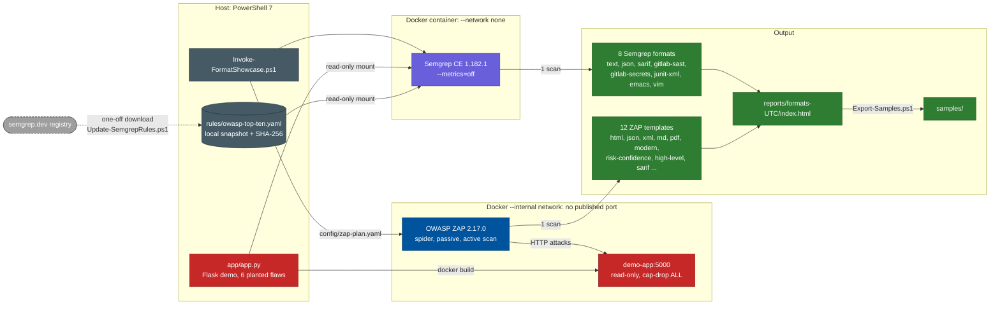

# Semgrep and ZAP report formats

**Which reports can the free versions of Semgrep (SAST) and OWASP ZAP (DAST) produce, and which one
should each reader get?** This proof of concept scans one small, deliberately vulnerable web app with
both tools. It writes every native report format from a single scan per tool and measures what each
format contains.


[](LICENSE)
[](https://github.com/stefanicla/semgrep-zap-report-formats/actions/workflows/lint.yml)
[](https://github.com/stefanicla/semgrep-zap-report-formats/commits/main)
[](https://github.com/stefanicla/semgrep-zap-report-formats)

> [!WARNING]
> [`app/app.py`](app/app.py) is **deliberately vulnerable**, and its database password is fake.
> It is a local scan target only: never deploy it. See [SECURITY.md](SECURITY.md).

> [!IMPORTANT]
> **Key findings**
> - **Semgrep: 8 formats, no document format.** Only `text` (console output) is meant for people.
>   In the free version the JSON report replaces the code line with *"requires login"*.
> - **ZAP: 12 report templates, all complete.** `traditional-html` is the one for Word documents
>   (18 A4 pages of real tables). The PDF is ready to send.
> - **Some formats mislead:** Semgrep's `gitlab-secrets` labels every finding as a secret. ZAP's PDF
>   job silently deletes an HTML report with the same name.
> - **The tools complement each other:** Semgrep finds the hard-coded password, ZAP finds the
>   cookie flags and missing security headers, and both find the injections.

## Contents

- [Quick start](#quick-start)
- [How it works](#how-it-works)
- [Prerequisites](#prerequisites)
- [Scripts](#scripts)
- [Results at a glance](#results-at-a-glance)
- [Repository layout](#repository-layout)
- [Design choices](#design-choices)
- [Limitations](#limitations)
- [Security](#security)
- [Contributing](#contributing)
- [Licence](#licence)

## Quick start

```powershell
git clone https://github.com/stefanicla/semgrep-zap-report-formats.git
cd semgrep-zap-report-formats

.\scripts\Update-SemgrepRules.ps1            # required once: downloads p/owasp-top-ten into rules\
.\scripts\Invoke-FormatShowcase.ps1 -Open    # Semgrep (~15 s) + ZAP (~2.5 min), all formats, overview page
.\scripts\Export-Samples.ps1                 # optional: one example of each format into samples\
```

Don't want to run anything? Every format is already in [`samples/`](samples/), with a guide in
[`samples/README.txt`](samples/README.txt).

## How it works



Only the dashed arrow needs the internet, once. The scans themselves run offline: Semgrep has no
network at all, and the demo app can be reached only by ZAP.

| Aspect | Details |
|---|---|
| **Goal** | Show every report format of both tools, with what each one contains and who it is for |
| **SAST** | Semgrep Community Edition 1.182.1 with the free `p/owasp-top-ten` ruleset (local snapshot, 559 rules) |
| **DAST** | OWASP ZAP 2.17.0, Automation Framework: spider, passive scan, short active scan, 12 report jobs |
| **Target** | [`app/app.py`](app/app.py): about 70 lines of Python/Flask, 6 planted flaws, known answer in [`app/expected.txt`](app/expected.txt) |
| **Evidence** | `reports/formats-<UTC>/` (all files and `index.html`, local only), [`samples/`](samples/) (one of each and `README.txt`) |

## Prerequisites

| Tool | Version used | Notes |
|---|---|---|
| PowerShell | 7.4+ (7.6 used) | Windows, Linux or WSL |
| Docker | Docker Desktop 29.x | Semgrep, ZAP and the demo app all run in containers. Nothing else is installed |
| Internet | Only for the first image pulls and `Update-SemgrepRules.ps1` | The scans themselves run offline |
| Microsoft Edge | Any recent version | Optional, only to build the infographic PDF (Windows) |

## Scripts

| Script | What it does |
|---|---|
| [`Invoke-FormatShowcase.ps1`](scripts/Invoke-FormatShowcase.ps1) | Runs both scans into `reports\formats-<UTC>\` and writes `index.html`. `-Tool semgrep\|zap` rescans one tool and reuses the other's last results. `-Open` opens the overview |
| [`Invoke-SemgrepScan.ps1`](scripts/Invoke-SemgrepScan.ps1) | One `semgrep scan` with all 8 `--<format>-output` options. `-Target` scans another folder |
| [`Invoke-ZapScan.ps1`](scripts/Invoke-ZapScan.ps1) | Starts the demo app on an internal Docker network, runs [`config/zap-plan.yaml`](config/zap-plan.yaml) and stops the app |
| [`Export-Samples.ps1`](scripts/Export-Samples.ps1) | Copies the newest showcase into `samples\` and writes `samples\README.txt` |
| [`Update-SemgrepRules.ps1`](scripts/Update-SemgrepRules.ps1) | Downloads or refreshes the ruleset snapshot and records its date, rule count and SHA-256 in `rules/SOURCE.txt` |
| [`Build-Infographic.ps1`](docs/infographic/Build-Infographic.ps1) | Prints the 4-page A4 infographic to PDF with headless Edge. `-Preview` also writes one PNG per page |

Every scan folder also has `scan.log` (console output) and `scan.meta.json` (tool version, image
digest, ruleset hash, command, duration and exit code).

> [!NOTE]
> A fresh download of the ruleset may differ from the snapshot used for `samples/`. Compare its
> SHA-256 with the one in [`rules/SOURCE.txt`](rules/SOURCE.txt). If they differ, the findings may
> differ slightly from the published numbers.

## Results at a glance

Full tables, the Word measurements and how to check each format by hand are in
**[docs/report-formats.md](docs/report-formats.md)**.

| Reader | Semgrep | ZAP |
|---|---|---|
| A person, a Word document | `text` (plain) | `traditional-html` → Word, or `traditional-pdf` |
| A manager | — | `high-level-report` |
| A developer | `sarif` in VS Code | `traditional-html-plus` or `modern` |
| GitHub code scanning | `sarif` | `sarif-json` |
| GitLab security dashboard | `gitlab-sast` | — |
| CI test results | `junit-xml` | — |
| Archive / automation | `json` | `traditional-json` |

## Repository layout

```text
.
├── app/                   demo app (Flask), Dockerfile (pinned base image), hash-pinned requirements, expected.txt
├── config/zap-plan.yaml   ZAP Automation Framework plan: scan jobs and one report job per template
├── docs/
│   ├── report-formats.md  the detailed results
│   └── infographic/       source of the 4-page PDF briefing (built into out/, gitignored)
├── rules/
│   ├── SOURCE.txt         URL, date, SHA-256 and licence of the snapshot used for samples/
│   └── owasp-top-ten.yaml downloaded by Update-SemgrepRules.ps1, not committed (licence)
├── samples/               one example of each format, and README.txt
├── scripts/               PowerShell scripts. lib/Common.ps1 holds the image pins and the format catalogue
└── reports/               scan output, one formats-<UTC> folder per run (gitignored)
```

## Design choices

| Choice | Why |
|---|---|
| **Everything in Docker, images pinned by digest** | Nothing to install on the host (no Python, Java or Semgrep). Tags can be moved but digests cannot. To upgrade, change the pins in `scripts/lib/Common.ps1` |
| **One scan per tool, all formats from it** | The formats are compared on exactly the same findings |
| **Local ruleset snapshot** | Registry rules change over time. The snapshot (with its SHA-256) makes results reproducible and lets Semgrep run with `--network none` |
| **No telemetry** | Semgrep uses `--metrics=off` and has no network. ZAP runs with `-silent` (no update checks or calls home) |
| **Demo app isolated** | It runs read-only, with no capabilities, on an `--internal` Docker network with no published port. ZAP's active scan reaches only that container |
| **Presence check, not a parser per format** | Searching each file for the rule IDs or alert names from the JSON report is simple and works for every text format. Open the files to confirm |

## Limitations

- One small Python app: the numbers (pages, sizes) show orders of magnitude, not benchmarks.
- ZAP's DOM-based XSS check needs a browser and may run out of time, so a run reports 11 or 12 alert types.
- The `p/owasp-top-ten` ruleset has no Python cookie rule, so Semgrep misses the insecure cookie.
- Semgrep's paid AppSec Platform (Pro rules, `semgrep ci`, dashboard) is out of scope.

## Security

The demo app's flaws are intentional, so please don't report them. To report a real issue in the
scripts or the isolation, see [SECURITY.md](SECURITY.md).

## Contributing

Issues and pull requests are welcome. See [CONTRIBUTING.md](CONTRIBUTING.md) and the
[code of conduct](CODE_OF_CONDUCT.md). Changes are listed in [CHANGELOG.md](CHANGELOG.md).

## Licence

This project is released under the [MIT Licence](LICENSE).

Third-party components keep their own terms:

- **Semgrep rules** (`p/owasp-top-ten`) are under the
  [Semgrep Rules License v1.0](https://semgrep.dev/legal/rules-license). That is why the ruleset is
  downloaded, not committed.
- **OWASP ZAP** is under the Apache License 2.0. The report assets in `samples/zap/` (Bootstrap,
  Chart.js, images) are shipped by ZAP's report templates under their own licences.
- **Semgrep CE** is under the LGPL 2.1.
